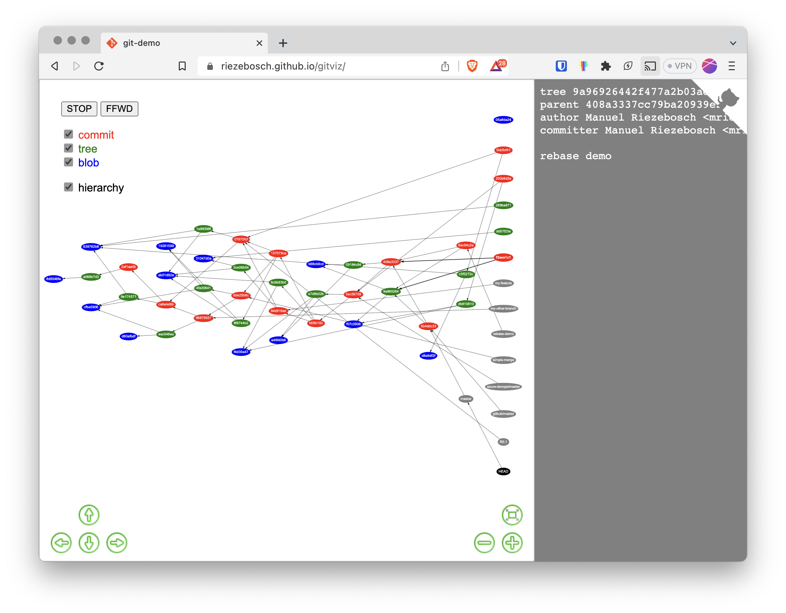

# gitviz

`gitviz` is an educational tool that visualizes a Git repository in real time. It renders a live graph of the [objects and references](https://eagain.net/articles/git-for-computer-scientists/) that make up Git's internal data structure — blobs, trees, commits, branches, tags, and HEAD.

[](https://riezebosch.github.io/gitviz/)

### Key Features

- Real-time graph that updates as you run Git commands
- Shows all four object types: blobs, trees, commits, and references (branches, tags, HEAD)
- Color-coded by type for quick visual distinction
- Designed for learning — no configuration needed

### Installation

Download the latest binary from [releases](https://github.com/riezebosch/gitviz/releases/latest) and unzip it.

**macOS only:** the first time you run it, you need to remove the quarantine flag:

```shell
xattr -d com.apple.quarantine ~/Downloads/gitviz
```

### Usage

Navigate to the root of a Git repository and run:

```sh
~/Downloads/gitviz
```

The graph will open automatically in your browser. Use `CTRL+C` to stop.

> **Note:** if `gitviz` is not on your `PATH`, invoke it directly — e.g. `~/Downloads/gitviz`. This works in bash, zsh, and PowerShell.

> **Tip:** run `git init` first if you are starting from an empty directory.

#### Running in the background

```sh
gitviz &
```

To stop it later:

```sh
kill %1
```